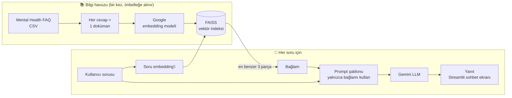

# 🧠 RAG Tabanlı Ruh Sağlığı Chatbotu

<p align="center">
  
  
  
  
  
  
</p>

Ruh sağlığıyla ilgili sorulara **yalnızca güvenilir bir bilgi havuzundaki** cevaplara dayanarak yanıt veren, **Retrieval-Augmented Generation (RAG)** mimarisiyle geliştirilmiş bir sohbet asistanı. *Akbank GenAI Bootcamp* kapsamında geliştirildi.

Asistan, sorulan konu bilgi havuzunda yoksa tahmin yürütmek yerine açıkça **"Bu konuda bilgim bulunmuyor."** diyor. Hassas bir alanda halüsinasyonu önlemek projenin ana tasarım hedefi.

> 🇬🇧 **In English:** A Retrieval-Augmented Generation chatbot that answers mental-health questions using only a curated FAQ knowledge base. Answers are embedded with Google embeddings and indexed in FAISS; for each question the top-3 most similar passages are retrieved and passed to Gemini with a grounding prompt that forces the model to say *"I don't have information on this"* when the context does not contain the answer. The app is served through a Streamlit chat interface, built with LangChain's LCEL.

<details>
<summary><b>📑 İçindekiler</b></summary>

- [Mimari](#mimari)
- [Öne çıkan özellikler](#öne-çıkan-özellikler)
- [Teknoloji yığını](#teknoloji-yığını)
- [Kurulum ve çalıştırma](#kurulum-ve-çalıştırma)
- [Klasör yapısı](#klasör-yapısı)
- [Veri](#veri)
- [Sınırlılıklar ve sonraki adımlar](#sınırlılıklar-ve-sonraki-adımlar)

</details>

## Mimari



1. **Hazırlık:** FAQ veri setindeki her cevap ayrı bir doküman olarak vektöre çevrilir ve FAISS indeksine yazılır. `st.cache_resource` sayesinde bu işlem uygulama açılışında yalnızca bir kez yapılır.
2. **Geri getirme (Retrieval):** Kullanıcının sorusu aynı embedding modeliyle vektöre çevrilir ve anlamca en yakın **3** cevap bulunur.
3. **Üretim (Generation):** Bulunan cevaplar bağlam olarak, kullanıcının sorusuyla birlikte Gemini'ye gönderilir. Prompt, modelin bağlam dışına çıkmasını yasaklar.

## Öne çıkan özellikler

| | |
|---|---|
| 🛡️ **Halüsinasyon kontrolü** | Bağlamda cevap yoksa model sabit bir "bilgim yok" yanıtı verir |
| ⚡ **Hızlı arama** | FAISS ile bellek içi anlamsal arama |
| 🔗 **LCEL zinciri** | `retriever → prompt → llm → parser` şeklinde okunabilir, modüler RAG akışı |
| 💬 **Sohbet geçmişi** | Streamlit `session_state` ile oturum boyunca mesajlar korunur |
| 🔐 **Güvenli anahtar yönetimi** | API anahtarı koda değil `.streamlit/secrets.toml` dosyasına yazılır ve git'e eklenmez |

## Teknoloji yığını

| Katman | Araç |
|---|---|
| RAG çatısı | LangChain (LCEL) |
| Dil modeli | Google Gemini (`ChatGoogleGenerativeAI`) |
| Embedding | Google Generative AI Embeddings |
| Vektör veritabanı | FAISS (yerel, bellek içi) |
| Arayüz | Streamlit |
| Veri işleme | pandas |

## Kurulum ve çalıştırma

```bash
git clone https://github.com/Memreu/Mental-Health-FAQ.git
cd Mental-Health-FAQ

python -m venv venv
source venv/bin/activate          # Windows: .\venv\Scripts\activate
pip install -r requirements.txt
```

**1. Veriyi ekle:** Kaggle'daki [Mental Health FAQ for Chatbot](https://www.kaggle.com/datasets/narendgeek/mental-health-faq-for-chatbot) veri setini indirip `Mental_Health_FAQ.csv` dosyasını proje klasörüne koy.

**2. API anahtarını tanımla:** [Google AI Studio](https://aistudio.google.com/app/apikey)'dan bir Gemini API anahtarı al ve şu dosyayı oluştur:

```toml
# .streamlit/secrets.toml
GOOGLE_API_KEY = "SENIN_API_ANAHTARIN"
```

**3. Uygulamayı başlat:**

```bash
streamlit run app.py
```

Tarayıcında `http://localhost:8501` adresi açılacak. Repo, [Streamlit Community Cloud](https://streamlit.io/cloud) veya [Hugging Face Spaces](https://huggingface.co/spaces) gibi ücretsiz platformlara doğrudan bağlanarak da yayınlanabilir; bu durumda API anahtarı platformun *secrets* ayarına eklenir.

## Klasör yapısı

```
├── app.py               # Streamlit arayüzü + RAG zinciri
├── requirements.txt     # Bağımlılıklar
├── mental_health.csv    # Ek veri dosyası
├── çalışma klavuzu.txt  # Kısa kurulum notları
├── LICENSE
└── README.md
```

## Veri

[Mental Health FAQ for Chatbot](https://www.kaggle.com/datasets/narendgeek/mental-health-faq-for-chatbot) (Kaggle): Ruh sağlığı konularındaki sık sorulan sorular (`Questions`) ve bunlara verilmiş açıklayıcı cevaplardan (`Answers`) oluşur. RAG'in geri getirme adımında her `Answers` metni ayrı bir doküman olarak indekslenir.

## Sınırlılıklar ve sonraki adımlar

- **Tıbbi tavsiye değildir.** Asistan bilgilendirme amaçlıdır; arayüze kriz durumları için profesyonel destek ve acil yardım hatlarını gösteren bir uyarı eklenmesi planlanıyor.
- **Değerlendirme.** Yanıt kalitesi şu an manuel olarak kontrol ediliyor. RAGAS gibi bir çerçeveyle *faithfulness* ve *context relevance* metrikleri ölçülebilir.
- **Daha iyi geri getirme.** Soru + cevap birlikte indekslenebilir, metin parçalama (chunking) ve yeniden sıralama (re-ranking) eklenebilir.
- **Çok dilli kullanım.** Veri seti İngilizce; Türkçe sorular için çeviri katmanı veya çok dilli bir embedding modeli kullanılabilir.
- **Kalıcı indeks.** FAISS indeksi diske kaydedilerek her açılışta yeniden embedding hesaplanması önlenebilir.

---

Bu proje [MIT lisansı](LICENSE) ile paylaşılmaktadır.

**Mehmet Emre Ünlü** · [GitHub](https://github.com/Memreu) · [LinkedIn](https://www.linkedin.com/in/memreu) · [Kaggle](https://www.kaggle.com/memreu)
