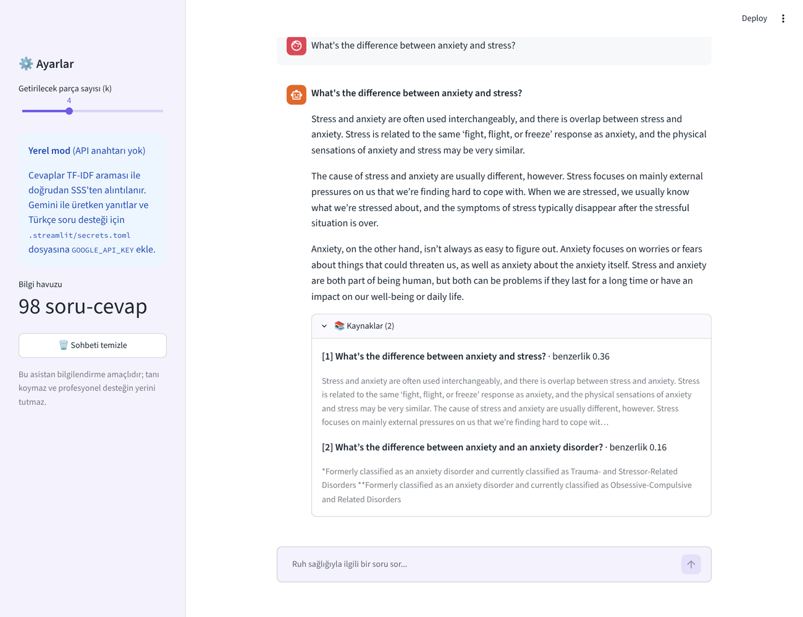
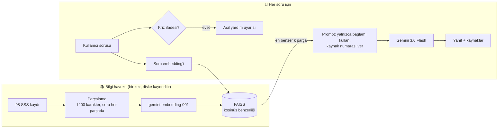
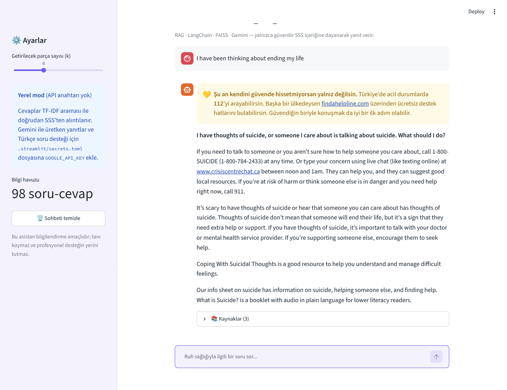

# 🧠 RAG Tabanlı Ruh Sağlığı SSS Asistanı

<p align="center">
  
  
  
  
  
  <a href="https://github.com/Memreu/Mental-Health-FAQ/actions/workflows/tests.yml"></a>
  
</p>

<p align="center">
  <a href="https://nbviewer.org/github/Memreu/Mental-Health-FAQ/blob/main/notebooks/rag_adim_adim.ipynb"></a>
  <a href="https://colab.research.google.com/github/Memreu/Mental-Health-FAQ/blob/main/notebooks/rag_adim_adim.ipynb"></a>
</p>

Ruh sağlığıyla ilgili sorulara **yalnızca güvenilir bir SSS bilgi havuzuna dayanarak** yanıt veren, **Retrieval-Augmented Generation (RAG)** mimarisiyle geliştirilmiş bir sohbet asistanı. İlk sürümü *Akbank GenAI Bootcamp* kapsamında geliştirildi.

Hassas bir alanda çalıştığı için üç ilke üzerine kurulu: **uydurmamak** (bağlamda cevap yoksa "bilgim yok" demek), **kaynak göstermek** (her yanıtın hangi SSS kaydından geldiğini göstermek) ve **güvenliği önceliklendirmek** (kriz ifadelerinde acil yardım bilgisini en üstte göstermek).

<p align="center"></p>

> 🇬🇧 **In English:** A Retrieval-Augmented Generation chatbot that answers mental-health questions using only a curated 98-item FAQ knowledge base. Long answers are chunked, embedded with `gemini-embedding-001` and indexed in FAISS (cosine similarity, persisted to disk); the top-k passages are passed to Gemini 3.6 Flash with a grounding prompt that forces a fixed *"I don't have information on this"* reply when the context is insufficient. Every answer shows its sources, crisis messages trigger an emergency-help banner, and the app also runs **without an API key** in a local TF-IDF mode. The project includes 16 unit tests (fake LLM and embeddings, no API key needed), a hand-written retrieval evaluation set and GitHub Actions CI.

<details>
<summary><b>📑 İçindekiler</b></summary>

- [Öne çıkan özellikler](#öne-çıkan-özellikler)
- [Mimari](#mimari)
- [Değerlendirme](#değerlendirme)
- [Adım adım notebook](#adım-adım-notebook)
- [Güvenlik tasarımı](#güvenlik-tasarımı)
- [Kurulum ve çalıştırma](#kurulum-ve-çalıştırma)
- [Testler](#testler)
- [Klasör yapısı](#klasör-yapısı)
- [Veri](#veri)
- [Sınırlılıklar ve sonraki adımlar](#sınırlılıklar-ve-sonraki-adımlar)

</details>

## Öne çıkan özellikler

| | |
|---|---|
| 🛡️ **Halüsinasyon kontrolü** | Prompt modeli yalnızca getirilen bağlamı kullanmaya zorlar; bağlam yetersizse sabit bir "bilgim yok" yanıtı döner ve kaynak gösterilmez |
| 📚 **Kaynak gösterimi** | Her yanıtın altında kullanılan SSS kayıtları, benzerlik skorları ve alıntılarla listelenir |
| 💛 **Kriz algılama** | Türkçe ve İngilizce intihar / kendine zarar ifadelerinde yanıtın üstünde acil yardım bilgisi gösterilir ve ilgili SSS önceliklendirilir |
| 🌍 **Çok dilli** | Gemini modunda Türkçe sorular İngilizce bilgi havuzunda aranır ve yanıt Türkçe verilir |
| 🔑 **Anahtarsız deneme** | API anahtarı yoksa uygulama yerel modda (TF-IDF + doğrudan SSS alıntısı) çalışmaya devam eder |
| ⚡ **Kalıcı indeks** | Embedding'ler bir kez hesaplanıp diske kaydedilir; veri değişirse indeks otomatik yenilenir |
| ✅ **Test ve CI** | 16 birim testi API anahtarı olmadan çalışır; her push'ta GitHub Actions ile test edilir |

## Mimari



| Dosya | Görev |
|---|---|
| `rag.py` | Veri yükleme, parçalama, FAISS / TF-IDF geri getirme, prompt, kriz algılama, `RAGPipeline` |
| `app.py` | Streamlit sohbet arayüzü, ayarlar, kaynak ve uyarı gösterimi |
| `evaluation/` | Elle yazılmış soru seti ve geri getirme değerlendirme betiği |
| `tests/` | Sahte embedding ve sahte LLM ile birim testleri |

## Değerlendirme

Geri getirme kalitesi, bilgi havuzundaki sorulardan **farklı kelimelerle** elle yazılmış 33 kapsam içi (25 İngilizce, 8 Türkçe) ve 6 kapsam dışı soruyla ölçülüyor ([`evaluation/eval_set.csv`](evaluation/eval_set.csv)).

**Yerel mod (TF-IDF, API anahtarı gerektirmez):**

| Dil | Soru | hit@1 | hit@3 | MRR |
|---|---:|---:|---:|---:|
| İngilizce | 25 | 0,80 | 0,88 | 0,84 |
| Türkçe | 8 | 0,12 | 0,12 | 0,12 |

- Kapsam dışı soruların **6/6**'sında doğru şekilde "bilgi yok" deniyor.
- Kelime tabanlı arama Türkçe soruları İngilizce metinle eşleştiremiyor; bu, çok dilli embedding kullanan **Gemini modunun** neden gerekli olduğunu gösteriyor.

Gemini modunun sonuçlarını kendi API anahtarınla üretmek için:

```bash
GOOGLE_API_KEY=... python evaluation/evaluate.py --mode gemini
```

## Adım adım notebook

Uygulamanın arkasındaki RAG hattı, aynı `rag.py` kodunu kullanan bir notebook'ta adım adım inceleniyor: [`notebooks/rag_adim_adim.ipynb`](notebooks/rag_adim_adim.ipynb)

| # | Bölüm | Ne gösteriyor? |
|---|---|---|
| 1 | Veriyi tanıma | Cevap uzunlukları (%53'ü 1.200 karakterden uzun), konu dağılımı |
| 2 | Parçalama | 98 cevabın 196 parçaya nasıl bölündüğü, neden her parçaya soru eklendiği |
| 3 | Geri getirme | Örnek sorularda gelen parçalar ve benzerlik skorları |
| 4 | Değerlendirme | hit@k / MRR, kaçırılan soruların nedenleri (eş anlamlılar, dil farkı) |
| 5 | "Bilgi yok" eşiği | Eşiğe göre doğru ve yanlış reddetme oranları, seçilen eşiğin gerekçesi |
| 6 | Gemini modu | API anahtarı varsa aynı ölçümlerin çok dilli embedding ile tekrarı |

Notebook API anahtarı olmadan baştan sona çalışır; [nbviewer](https://nbviewer.org/github/Memreu/Mental-Health-FAQ/blob/main/notebooks/rag_adim_adim.ipynb)'da çıktılarıyla okunabilir, [Colab](https://colab.research.google.com/github/Memreu/Mental-Health-FAQ/blob/main/notebooks/rag_adim_adim.ipynb)'da tek tıkla açılır.

## Güvenlik tasarımı

<p align="center"></p>

- **Kriz algılama:** "intihar", "kendime zarar", "ending my life" gibi ifadeler düzenli ifadelerle yakalanır. Bu durumda yanıtın üstünde Türkiye için **112** ve uluslararası destek hatları için [findahelpline.com](https://findahelpline.com) gösterilir; arama sorgusu intihar SSS kaydını bulacak şekilde güçlendirilir.
- **Tanı ve doz yok:** Sistem promptu modelin tanı koymasını ve ilaç dozu önermesini yasaklar, uygun durumlarda uzmana yönlendirir.
- **Anahtar güvenliği:** API anahtarı `.streamlit/secrets.toml` veya ortam değişkeninden okunur; bu dosya `.gitignore`'dadır.

## Kurulum ve çalıştırma

```bash
git clone https://github.com/Memreu/Mental-Health-FAQ.git
cd Mental-Health-FAQ
python -m venv venv
source venv/bin/activate          # Windows: .\venv\Scripts\activate
pip install -r requirements.txt
streamlit run app.py
```

Uygulama bu haliyle **yerel modda** açılır. Gemini moduna geçmek için [Google AI Studio](https://aistudio.google.com/app/apikey)'dan ücretsiz bir API anahtarı al ve örnek dosyayı kopyala:

```bash
cp .streamlit/secrets.toml.example .streamlit/secrets.toml
# secrets.toml içine GOOGLE_API_KEY = "..." yaz
```

| Ayar (`secrets.toml` veya ortam değişkeni) | Varsayılan |
|---|---|
| `GOOGLE_API_KEY` | — (yoksa yerel mod) |
| `GEMINI_MODEL` | `gemini-3.6-flash` |
| `GEMINI_EMBEDDING_MODEL` | `gemini-embedding-001` |

Repo, [Streamlit Community Cloud](https://streamlit.io/cloud)'a doğrudan bağlanarak da yayınlanabilir; API anahtarı platformun *Secrets* ayarına eklenir.

## Testler

```bash
pip install -r requirements-dev.txt   # testler + notebook için
pytest -q
```

Testler gerçek API çağrısı yapmaz: `DeterministicFakeEmbedding` ve `FakeListChatModel` ile veri yükleme, parçalama, yerel ve LLM modları, "bilgi yok" davranışı, kriz algılama, indeksin diske kaydedilip yeniden kullanılması ve Gemini ayarları doğrulanır.

## Klasör yapısı

```
├── app.py                         # Streamlit arayüzü
├── rag.py                         # RAG çekirdeği
├── data/
│   └── Mental_Health_FAQ.csv      # 98 soru-cevaplık bilgi havuzu
├── notebooks/
│   └── rag_adim_adim.ipynb        # Veri, parçalama, geri getirme ve değerlendirme adım adım
├── evaluation/
│   ├── eval_set.csv               # Elle yazılmış değerlendirme soruları
│   └── evaluate.py                # hit@k / MRR hesaplama
├── tests/
│   └── test_rag.py                # Birim testleri
├── .streamlit/
│   ├── config.toml                # Tema
│   └── secrets.toml.example       # API anahtarı şablonu
├── .github/workflows/tests.yml    # CI
├── images/                        # README ekran görüntüleri
├── requirements.txt
├── requirements-dev.txt
├── LICENSE
└── README.md
```

## Veri

[Mental Health FAQ for Chatbot](https://www.kaggle.com/datasets/narendgeek/mental-health-faq-for-chatbot) (Kaggle): Ruh sağlığı konularında 98 soru (`Questions`) ve açıklayıcı cevap (`Answers`). İçerik büyük ölçüde Kanada'daki [HeretoHelp](https://www.heretohelp.bc.ca/questions-and-answers) ve benzeri kuruluşların SSS sayfalarından derlenmiştir. Cevaplar 93 ile 8.500 karakter arasında değiştiği için 1.200 karakterlik parçalara bölünür ve her parçanın başına ait olduğu soru eklenir.

## Sınırlılıklar ve sonraki adımlar

- **Tıbbi tavsiye değildir.** Asistan bilgilendirme amaçlıdır ve profesyonel desteğin yerini tutmaz.
- **Bölgesel içerik.** Bilgi havuzundaki yardım hatları ve kurumlar Kanada'ya (British Columbia) özgü. Türkiye'deki kaynaklarla (ör. ruh sağlığı merkezleri, MHRS) genişletilmesi planlanıyor.
- **Gemini modu değerlendirmesi.** Yerel mod sonuçları yukarıda; Gemini modunun geri getirme ve yanıt kalitesi (ör. RAGAS ile *faithfulness*) API anahtarıyla ayrıca ölçülmeli.
- **Kriz algılama kural tabanlı.** Anahtar kelime listesi dolaylı ifadeleri kaçırabilir; küçük bir sınıflandırıcı veya LLM tabanlı ikinci kontrol eklenebilir.
- **Sohbet bağlamı.** Her soru bağımsız işleniyor; takip sorularını önceki mesajlarla birlikte yeniden yazan bir adım (query rewriting) eklenebilir.

---

Bu proje [MIT lisansı](LICENSE) ile paylaşılmaktadır.

**Mehmet Emre Ünlü** · [GitHub](https://github.com/Memreu) · [LinkedIn](https://www.linkedin.com/in/memreu) · [Kaggle](https://www.kaggle.com/memreu)
