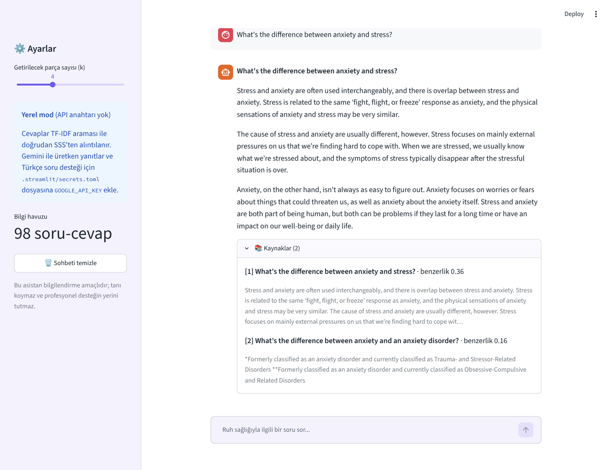

# Ruh Sağlığı SSS Asistanı (RAG)

Bu proje, ruh sağlığıyla ilgili sorulara yalnızca hazır bir SSS bilgi havuzundan yararlanarak cevap veren bir sohbet asistanı. İlk sürümünü Akbank GenAI Bootcamp sırasında yazdım, sonra geri getirme kısmını ölçülebilir hale getirip testlerle birlikte yeniden düzenledim.

Bu bir tıbbi tavsiye aracı değildir; bilgilendirme amaçlıdır ve profesyonel desteğin yerini tutmaz.



## Nasıl çalışıyor

Bilgi havuzu Kaggle'daki [Mental Health FAQ for Chatbot](https://www.kaggle.com/datasets/narendgeek/mental-health-faq-for-chatbot) veri setindeki 98 soru-cevap kaydı. İçerik büyük ölçüde Kanada'daki [HeretoHelp](https://www.heretohelp.bc.ca/questions-and-answers) ve benzeri kuruluşların SSS sayfalarından derlenmiş. Cevaplar 93 ile 8.500 karakter arasında değiştiği için 1.200 karakterlik parçalara bölünüyor (98 cevaptan 196 parça çıkıyor) ve her parçanın başına ait olduğu soru ekleniyor. Parçalar `gemini-embedding-001` ile vektöre çevrilip kosinüs benzerliğiyle FAISS'te aranıyor; indeks bir kez hesaplanıp diske kaydediliyor.

Gelen soruya en yakın k parça, modele "yalnızca bu bağlamı kullan" diyen bir promptla Gemini 3.6 Flash'a gidiyor. Bağlam yetersizse model sabit bir "bilgim yok" cevabı veriyor. Her cevabın altında hangi SSS kaydından geldiği ve benzerlik skoru görünüyor. API anahtarı yoksa uygulama TF-IDF ile çalışan yerel moda geçiyor ve doğrudan ilgili SSS metnini alıntılıyor.

Hassas bir konu olduğu için iki ek önlem var. "intihar", "kendime zarar", "ending my life" gibi ifadeler yakalandığında cevabın üstünde Türkiye için 112 ve uluslararası destek hatları için [findahelpline.com](https://findahelpline.com) gösteriliyor. Sistem promptu da modelin tanı koymasını ve ilaç dozu önermesini yasaklıyor.

## Geri getirme ne kadar iyi

Bunu ölçmek için bilgi havuzundaki sorulardan farklı kelimelerle 33 kapsam içi (25 İngilizce, 8 Türkçe) ve 6 kapsam dışı soru yazdım ([`evaluation/eval_set.csv`](evaluation/eval_set.csv)). Yerel modda (TF-IDF) sonuçlar şöyle:

| Dil | Soru | hit@1 | hit@3 | MRR |
|---|---:|---:|---:|---:|
| İngilizce | 25 | 0,80 | 0,88 | 0,84 |
| Türkçe | 8 | 0,12 | 0,12 | 0,12 |

Kapsam dışı 6 sorunun 6'sında da doğru şekilde "bilgi yok" deniyor. Türkçe sonucun bu kadar düşük çıkması beklenen bir durum: kelime tabanlı arama Türkçe soruyu İngilizce metinle eşleştiremiyor. Çok dilli embedding kullanan Gemini modunun neden gerekli olduğunu en iyi bu tablo gösteriyor. Gemini modunu henüz aynı setle ölçmedim; kendi anahtarınızla şöyle çalıştırabilirsiniz:

```bash
GOOGLE_API_KEY=... python evaluation/evaluate.py --mode gemini
```

Veriyi tanımadan eşik seçimine kadar bütün adımları [`notebooks/rag_adim_adim.ipynb`](notebooks/rag_adim_adim.ipynb) içinde aynı `rag.py` koduyla tek tek gösterdim. Notebook API anahtarı olmadan çalışıyor; [nbviewer](https://nbviewer.org/github/Memreu/Mental-Health-FAQ/blob/main/notebooks/rag_adim_adim.ipynb) üzerinden çıktılarıyla okunabilir.

## Çalıştırma

```bash
git clone https://github.com/Memreu/Mental-Health-FAQ.git
cd Mental-Health-FAQ
pip install -r requirements.txt
streamlit run app.py
```

Uygulama bu haliyle yerel modda açılır. Gemini modu için [Google AI Studio](https://aistudio.google.com/app/apikey)'dan bir anahtar alıp `.streamlit/secrets.toml.example` dosyasını `secrets.toml` olarak kopyalamak ve içine `GOOGLE_API_KEY` yazmak yeterli. Model adları `GEMINI_MODEL` ve `GEMINI_EMBEDDING_MODEL` ile değiştirilebilir.

Testler (`pip install -r requirements-dev.txt` ve `pytest -q`) gerçek API çağrısı yapmıyor; sahte embedding ve sahte LLM ile 16 test çalışıyor ve her push'ta GitHub Actions'ta tekrarlanıyor.

## Sınırlılıklar

Bilgi havuzundaki yardım hatları ve kurumlar Kanada'ya (British Columbia) özgü; Türkiye'deki kaynaklarla genişletmeyi düşünüyorum. Kriz algılama kural tabanlı olduğu için dolaylı ifadeleri kaçırabilir. Her soru bağımsız işlendiğinden takip soruları önceki mesajlarla birlikte yorumlanmıyor. Gemini modunun cevap kalitesi de (ör. RAGAS ile faithfulness) ayrıca ölçülmeli.

Proje [MIT lisansı](LICENSE) ile paylaşılıyor.

Mehmet Emre Ünlü · [GitHub](https://github.com/Memreu) · [LinkedIn](https://www.linkedin.com/in/memreu) · [Kaggle](https://www.kaggle.com/memreu)
